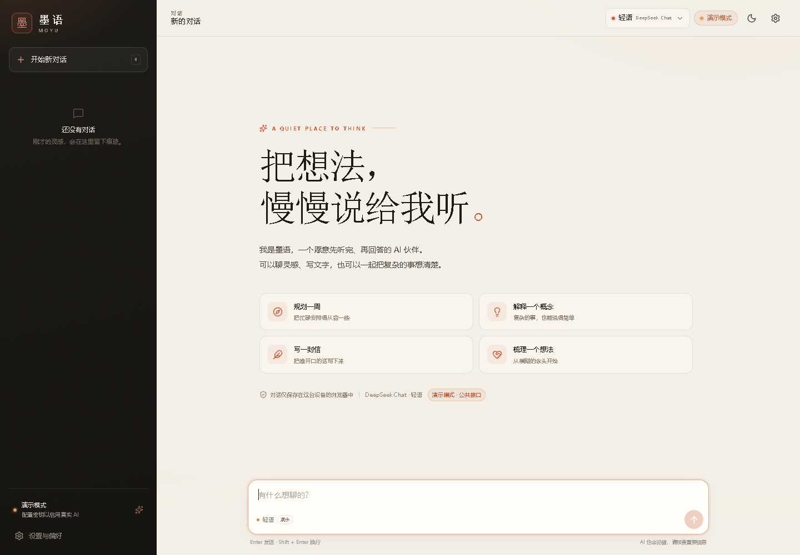
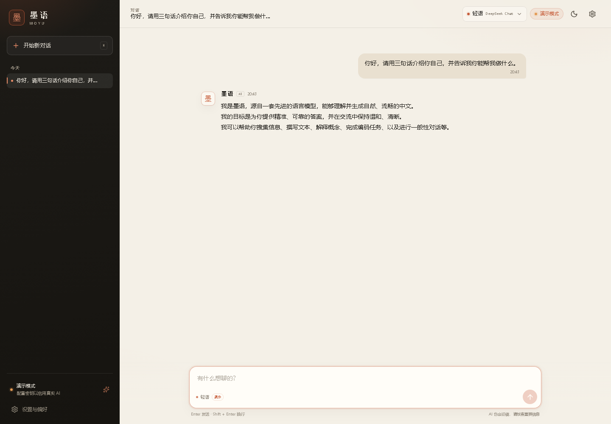
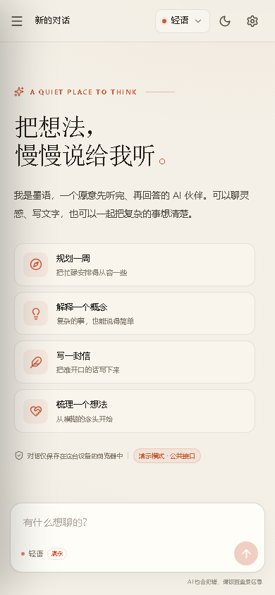
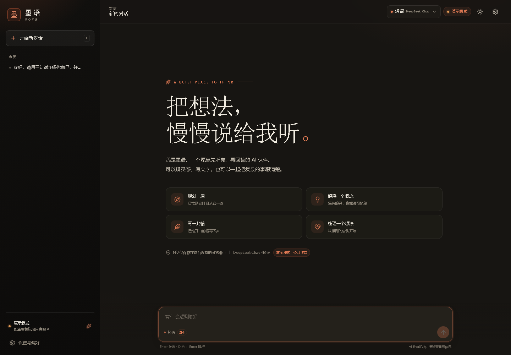
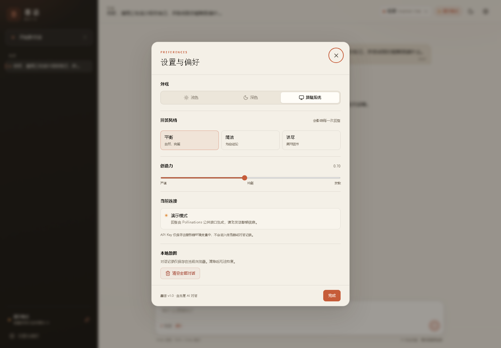

# 墨语 · Moyu Chat

一个安静、克制、可以直接部署到公网的 AI 聊天应用。服务端代理 DeepSeek（或任何 OpenAI 兼容接口）的流式响应，API Key 不会进入浏览器；对话记录只保存在访客自己的浏览器里。



## 预览

| 对话 | 移动端 |
| --- | --- |
|  |  |

| 深色模式 | 设置 |
| --- | --- |
|  |  |

  

## 功能

- 流式输出，支持 Markdown、表格、代码高亮和一键复制
- DeepSeek Chat / Reasoner 双模型切换，推理过程可折叠查看
- 深色 / 浅色 / 跟随系统三种主题，移动端侧边抽屉
- 多会话本地保存（localStorage），可删除单条或清空全部
- 服务端代理 API Key，SSE 转发、心跳、超时与中断处理
- 按 IP 限流（分钟 / 每日），请求体大小与上下文长度限制
- 未配置 Key 时自动进入演示模式，开箱即可看完整界面
- 单进程部署：一个 Docker 镜像同时提供前端静态文件和 API

## 快速开始

需要 **Node.js >= 22.18**（推荐 24）。

```bash
npm install
cp .env.example .env
# 编辑 .env，填入 DEEPSEEK_API_KEY
npm run dev
```

打开 `http://127.0.0.1:5173`。开发模式下 Vite 会把 `/api` 代理到 `http://127.0.0.1:8787`。

生产模式：

```bash
npm run build
npm start
# http://127.0.0.1:8787
```

> 没有 API Key 也能启动：默认是本地演示模式。设置 `DEMO_PROVIDER=pollinations` 可以接入免费的公共演示接口，让预览页真的能聊天（见下方隐私说明）。

## 获取 DeepSeek API Key

1. 打开 <https://platform.deepseek.com/> 注册并创建 API Key。
2. 把 Key 写入服务器的环境变量 `DEEPSEEK_API_KEY`，不要写进前端代码或提交到 Git。
3. 重启服务后，页面右上角的状态会从「演示模式」变为「在线」。

模型 ID 默认是 `deepseek-chat` 和 `deepseek-reasoner`。如果你使用其他 OpenAI 兼容服务，可设置 `DEEPSEEK_BASE_URL` 和对应的模型 ID：

```dotenv
DEEPSEEK_BASE_URL=https://your-provider.example.com/v1
DEEPSEEK_MODEL=your-chat-model
DEEPSEEK_REASONER_MODEL=your-reasoner-model
ENABLE_REASONER=false
```

## 部署到公网

### 方案 A：Render（推荐，免费层可用）

1. 把项目推到一个 GitHub 仓库：

   ```bash
   git init
   git add .
   git commit -m "feat: Moyu Chat"
   git branch -M main
   git remote add origin https://github.com/<你的用户名>/moyu-chat.git
   git push -u origin main
   ```

2. 登录 [Render Dashboard](https://dashboard.render.com/) → **New** → **Blueprint**。
3. 选择这个仓库。Render 会自动读取根目录的 `render.yaml`。
4. 在环境变量里填入 `DEEPSEEK_API_KEY`（标记为 secret），点击 **Apply / Deploy**。
5. 等待构建完成，访问 Render 提供的 `https://<service>.onrender.com`。

说明：

- `render.yaml` 使用 Docker、`singapore` 区域和免费套餐。免费实例闲置后会休眠，首次访问需要几十秒唤醒。
- 如果暂时不配置 Key，保留 `DEMO_PROVIDER=pollinations` 也能聊天；正式对外运营时建议换成自己的 Key，或改成 `DEMO_PROVIDER=local`。
- 需要自定义域名时，在 Render 的 **Settings → Custom Domains** 绑定域名并按提示配置 DNS。

### 方案 B：Railway

```bash
npm i -g @railway/cli
railway login
railway init
railway up
```

然后在 Railway 项目的 **Variables** 中添加 `DEEPSEEK_API_KEY`。仓库里的 `railway.json` 已配置 Dockerfile 构建和 `/api/health` 健康检查。

### 方案 C：任意 VPS / Docker

```bash
docker build -t moyu-chat .
docker run -d --name moyu \
  -p 3000:3000 \
  -e DEEPSEEK_API_KEY=sk-xxxxxxxx \
  --restart unless-stopped \
  moyu-chat
```

配合 Nginx / Caddy 反向代理到 `127.0.0.1:3000` 并配置 HTTPS。SSE 已经设置 `X-Accel-Buffering: no`，Nginx 不需要额外关闭缓冲。

也可以直接用 Compose：

```bash
cp .env.example .env
# 填写 .env
docker compose up -d --build
```

### 临时公网预览

没有服务器时，可以用 Cloudflare Quick Tunnel 把本机服务暴露到公网：

```bash
cloudflared tunnel --url http://127.0.0.1:8787
```

它会输出一个 `https://<随机名>.trycloudflare.com` 地址。**这是临时地址**，进程退出即失效，不适合作为正式服务。

## 环境变量

| 变量 | 默认值 | 说明 |
| --- | --- | --- |
| `DEEPSEEK_API_KEY` | 空 | DeepSeek 或兼容服务的密钥；为空时进入演示模式 |
| `DEEPSEEK_BASE_URL` | `https://api.deepseek.com` | API 根地址 |
| `DEEPSEEK_MODEL` | `deepseek-chat` | 普通对话模型 ID |
| `DEEPSEEK_REASONER_MODEL` | `deepseek-reasoner` | 推理模型 ID |
| `ENABLE_REASONER` | `true` | 设为 `false` 则只展示普通模型 |
| `DEMO_MODE` | `auto` | `auto` / `on` / `off` |
| `DEMO_PROVIDER` | `local` | `local` 本地示例；`pollinations` 公共演示接口 |
| `DEMO_MODEL` | `openai` | 公共演示接口使用的模型 |
| `SYSTEM_PROMPT` | 内置墨语人设 | 覆盖服务端系统提示词 |
| `MAX_INPUT_CHARS` | `40000` | 单次请求的上下文字符上限 |
| `MAX_OUTPUT_TOKENS` | `4096` | 模型最大输出 token |
| `UPSTREAM_TIMEOUT_MS` | `120000` | 上游请求超时 |
| `RATE_LIMIT_PER_MINUTE` | `12` | 每 IP 每分钟请求上限 |
| `RATE_LIMIT_PER_DAY` | `240` | 每 IP 每日请求上限 |
| `PORT` | `8787` | 监听端口；Render/Railway 会自动注入 |
| `HOST` | `0.0.0.0` | 监听地址 |

## 项目结构

```text
moyu-chat/
├─ server/index.ts        # Express API、SSE 代理、限流、静态文件
├─ src/
│  ├─ App.tsx             # 会话状态、发送 / 停止 / 重新生成
│  ├─ components/         # 侧栏、消息、输入框、设置、模型选择
│  ├─ lib/chat.ts         # 前端 SSE 解析
│  └─ styles.css          # 设计系统与响应式样式
├─ Dockerfile
├─ render.yaml
└─ railway.json
```

## 安全与隐私

- **API Key 只在服务端**：前端只调用 `/api/chat`，密钥不会出现在 bundle、网络响应或 localStorage 中。
- **对话不落服务器**：服务端不做数据库持久化；历史记录保存在访客浏览器。清除浏览器数据即清除对话。
- **限流是进程内存级**：单实例足够防误用；如果横向扩容，需要换成 Redis 等共享存储，否则每个实例独立计数。
- **公开站点仍可能被刷**：建议保留限流，必要时增加登录、Cloudflare Turnstile 或每日预算上限。`RATE_LIMIT_PER_DAY` 只限制请求次数，不限制 token 消耗。
- **演示模式**：`DEMO_PROVIDER=pollinations` 会把对话内容发送到第三方公共接口，请勿输入敏感信息，也不建议作为正式生产后端。正式使用请配置自己的 `DEEPSEEK_API_KEY`。
- **内容安全**：本项目不包含内容审核。面向公众开放时，请遵守所在地区法规和模型服务商的使用条款。

## 常见问题

**页面显示「演示模式」，配置了 Key 还是没变？**

确认 Key 写在**运行服务的进程环境**中，而不是只写在本地 `.env` 却没重启；Docker 部署需要 `-e` 或 `env_file`。访问 `/api/health` 可检查 `mode`。

**回答到一半停了？**

检查反向代理的超时设置。服务端默认 120 秒上游超时，并每 15 秒发送 SSE 心跳。Cloudflare 免费版对长连接有 100 秒限制，长回答可能被断开。

**可以换成 OpenAI / 其他模型吗？**

可以。把 `DEEPSEEK_BASE_URL` 指向兼容 `/chat/completions` 的服务，并设置模型 ID；鉴权仍使用 `DEEPSEEK_API_KEY`。如需不同的鉴权头或请求字段，改 `server/index.ts` 里的 `pipeOpenAiStream` 调用即可。

**为什么构建脚本带 `--configLoader native`？**

Vite 8 在 Windows 沙箱里会调用 `net use` 探测网络盘，可能触发 `spawn EPERM`。`--configLoader native` 让 Node 直接加载 `vite.config.ts`，避开这个问题，对 Linux/Docker 同样有效。

## License

MIT
